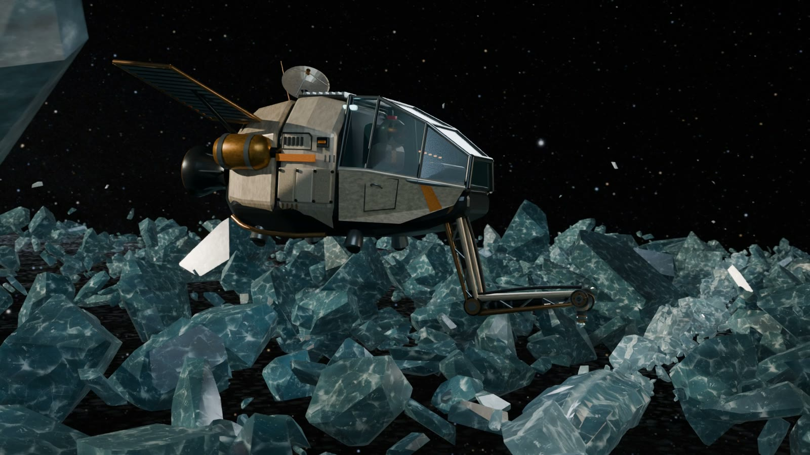
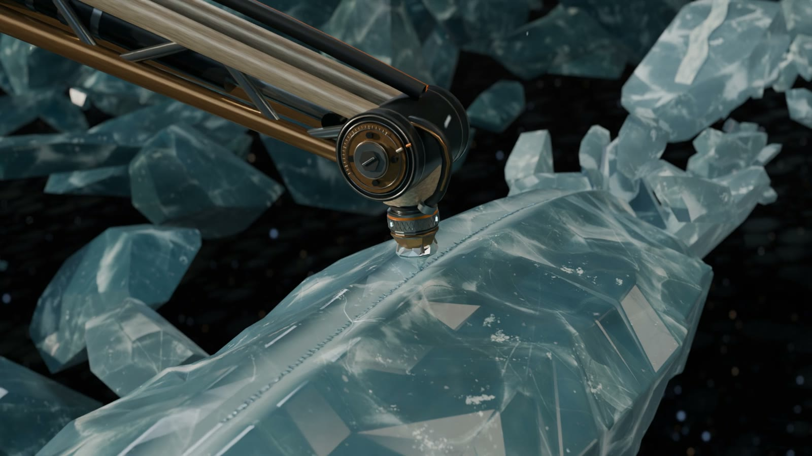
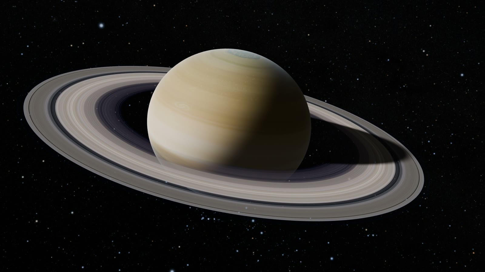

# 01 · Satürn'ün İğnesi (GPT-6.2 Astra + Blender)

**Ne denendi:** Astra'ya Blender MCP erişimi verilip üç saatlik bir goal ile 30-40 saniyelik, sesli bir bilimkurgu kısa filmi istendi. Fikir: Satürn'ün halkalarında ilerleyen küçük bir keşif aracı aslında bir pikap iğnesi, halkalar da bir plak.

| | |
|---|---|
| Model | GPT-6.2 Astra (goal turu). Fikir sohbetinin ilk iki turu kayıtta GPT-6.2 Sol, High |
| Efor | Extra High (goal turu) |
| Araçlar | Codex Desktop, Blender MCP, Blender'ın Python ve komut satırı render araçları |
| Alt ajan | Taha'nın isteğiyle yalnız GPT-6.2 Astra. Kayıtta 3 alt oturum var |
| Tek prompt mu | Hayır. Önce fikir sohbeti, sonra uzun bir goal |
| Süre | Goal turu 177,5 dk (kayıttaki görev süresi). Hedef 3 saatti |
| Sonuç | 36 sn, 1920×1080, 24 fps, sesli MP4 ve düzenlenebilir .blend projesi |

## Sonuç

Kareler son MP4'ün 4., 14. ve 30. saniyesinden alındı. MP4 (43 MB) ve .blend (222 MB) boyut sınırı yüzünden repoda yok.

Kurgu notundaki kayıtlı tespitler:
- Yakın buz parçalarının arasındaki açıklıklar uzak planda dikdörtgen bir leke oluşturdu. Parçaları kendi merkezlerine doğru mesafeyle küçültmek geçişi düzeltti.
- Kaydedilmiş projede eldivenin dört malzeme yuvası boş çıktı. Düzeltme projenin ayrı bir kopyasına uygulandı ve kare Cycles ile yeniden render alındı (alt oturumun son mesajından).
- Sahneler ayrı Python modüllerinde kuruldu: `eclipse.py`, `contact.py`, `cockpit_candidate.py`, `rings.py`, `sound.py`, `master.py`. Gezegen dokusu Solar System Scope, buz yüzeyi ambientCG kaynaklı.

Taha videoda: "Şurada küçük bir problem var. Farkındaysanız Blender'da. Ancak onun dışında genel olarak sahne çok güzel. Çok detaylı bir sahne yapmış. Gayet kaliteli. Efektler çok güzel."

Prompt ve takip mesajları: [prompt.md](prompt.md)
