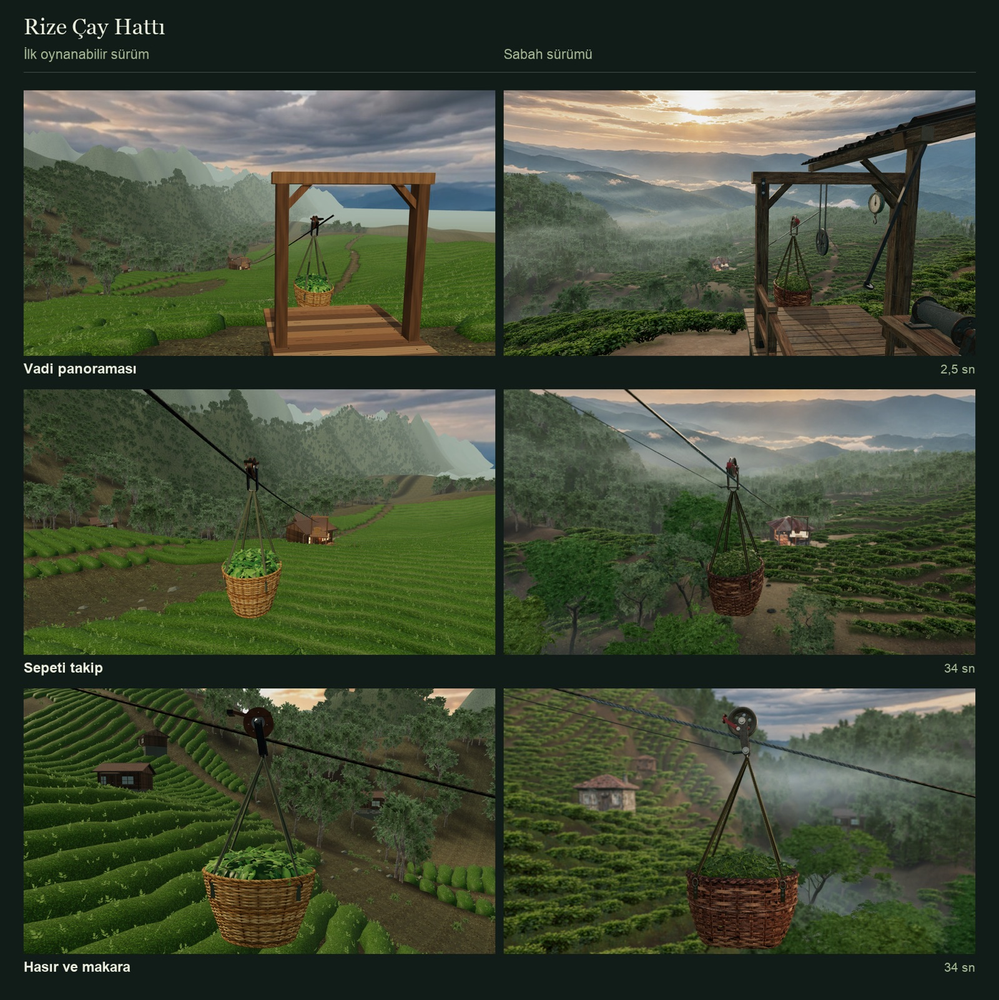
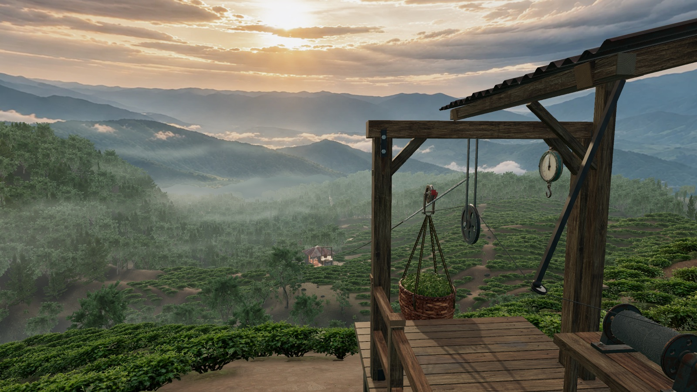
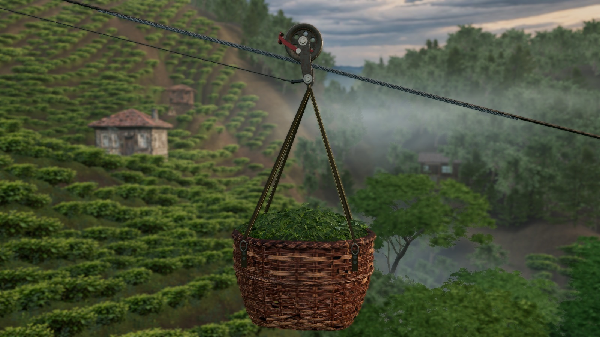

# 02 · Rize Çay Hattı (GPT-6.2 Astra, gece boyu goal, Higgsfield ile özel asset)

**Ne denendi:** Three.js ile Rize'den esinlenen, tarayıcıda oynanan bir 3B sahne: çay sepeti halatla vadiden iniyor, oyuncu freni tutup bırakarak inişi yönetiyor. Astra'ya bütün gece süren bir goal verildi. Konsept ve referans görselleri Codex'in yerleşik ImageGen aracıyla, dokulu 3B modeller ve iki ses Higgsfield ile üretildi.

| | |
|---|---|
| Model | GPT-6.2 Astra (goal turu ve 3 alt ajan). Goal'dan önceki planlama turları kayıtta GPT-6.2 Sol |
| Efor | Max (goal turu). Alt ajan kayıtlarında efor `low` görünüyor |
| Araçlar | Codex Desktop, Three.js, yerleşik ImageGen, Higgsfield (3B model ve ses) |
| Tek prompt mu | Hayır. Planlama sohbeti, sonra goal ve gece boyunca takip mesajları |
| Süre | Goal turu 389,4 dk, yani yaklaşık 6,5 saat (kayıttaki görev süresi) |
| Sonuç | Oynanabilir Three.js projesi, 20 sn sesli 1080p demo videosu, ilk ve son sürüm karşılaştırması |

## Sonuç

Solda ilk oynanabilir sürüm, sağda sabah sürümü. Üç açı aynı kamera konumundan çekildi.

Sabah notundaki ölçümler (Apple M5, Chrome, 1920×1080):

| Koşul | Sürüş | Sefer süresi | Temas hızı | Ortalama FPS |
|---|---|---:|---:|---:|
| Tek oyun penceresi | Frensiz iniş | 66,86 sn | 1,32 m/sn | 119,93 |
| Tek oyun penceresi | Son yaklaşmada fren | 72,85 sn | 0,43 m/sn | 119,94 |
| Eşzamanlı grafik testleriyle | Frensiz iniş | 66,86 sn | 1,32 m/sn | 50,38 |

- Aynı oturumda 36 tam sefer (18 sert, 18 yumuşak iniş). Konsol hatası ve başarısız varlık isteği sıfır.
- Higgsfield'da on dokulu 3B model ve iki ses üretildi. Bir panorama denemesi oyunda kullanılmadı.
- Modelin kendi yazdığı kalan kusurlar: en uzak dağlar panoramaya işlendiği için serbest kamera yana kayarken sırtlar sabit kalıyor.

Oyun paketi (440 MB) ve videolar boyut sınırı yüzünden repoda yok.

Taha videoda: "İlk versiyonuna çok iyi başlamadı. Ama ondan sonra adım adım adım adım adım adım çok daha iyi hale geldi." ve "Model üzerine uğraştıkça, bir görev üzerine uğraşmaya devam ettikçe çok daha iyi sonuçlar alan bir model. Uzun görevleri otonom goal olarak vermekten çekinmemeniz gereken bir model." Özel asset konusunda: "Her şeyi kodla yapmamamız lazım. Özel asetle desteklememiz lazım."

Prompt ve takip mesajları: [prompt.md](prompt.md)
