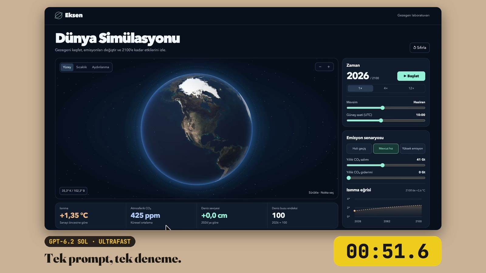
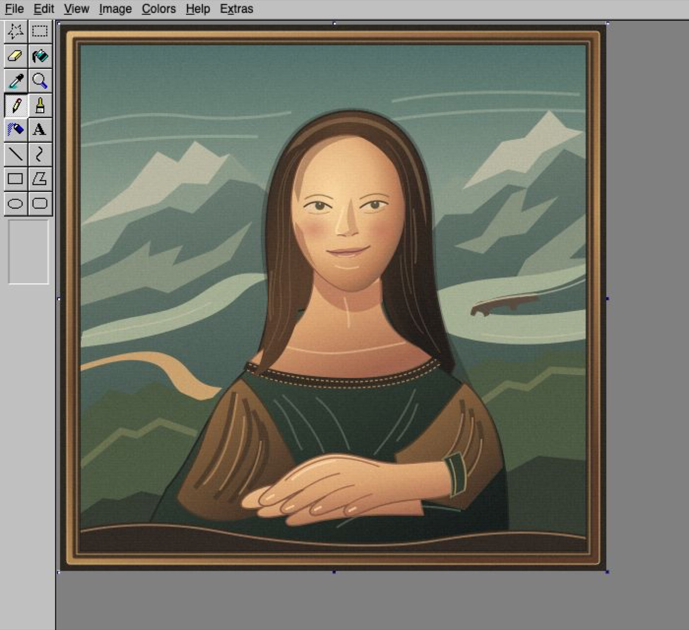

# 04 · GPT-6.2 Sol, Ultra Fast: tek prompt hız testleri ve bilgisayar kullanımı

**Ne denendi:** Sol'un Ultra Fast hız katmanında iki şey: tek promptla bir dünya simülasyonu (hız + kalite) ve Computer aracıyla tarayıcıda bir hafıza oyunu oynamak. İkisi de videoda sayaçlı kliplerle gösterildi. Aynı gece bir de Paint'te Mona Lisa denemesi yapıldı (videoda yok).

Hepsi 18 Kasım gecesi (01:25-01:33, İstanbul saati), ayrı Codex Desktop sohbetlerinde.

| Test | Model | Efor | Hız | Tek prompt mu | Süre (kayıt) | Sonuç |
|---|---|---|---|---|---|---|
| Dünya simülasyonu | GPT-6.2 Sol | Medium | Ultra Fast | Evet | Görev 48,0 sn. Klipteki sayaç (prompttan sonuca) 51,6 sn | "Eksen" tek HTML: döndürülebilen küre, mevsim ve güneş saati, üç emisyon senaryosuyla 2100'e kadar ısınma, CO₂, deniz seviyesi, deniz buzu |
| Hafıza oyunu (Computer) | GPT-6.2 Sol | Medium | Ultra Fast | Evet | Görev 35,4 sn. Oyun 14 sn, 13 hamle, 8/8 çift | Hızlandırma yok, gerçek hız |
| Hafıza oyunu, ilk deneme | GPT-6.2 Sol | Medium | Ultra Fast | Hayır (3 mesaj) | Oyun 25 sn, 11 hamle | 4×4 tur tamamlandı |
| Mona Lisa, Paint (Computer) | GPT-6.2 Sol | Medium | Ultra Fast | Hayır (2 mesaj) | Görev 79,3 sn | Çizim açık Paint tuvaline yerleştirildi |

## Sonuç

Dünya simülasyonunun kendisi: [sonuc/eksen-dunya-simulasyonu.html](sonuc/eksen-dunya-simulasyonu.html) (tek dosya, çevrimdışı açılır). Modelin kendi notu: "İklim hesapları basitleştirilmiş bir eğitim modeline dayanıyor."

Taha videoda: "Ultra Fast modunu bilmeyenler için çok daha hızlı oluyor. Aşırı hızlı oluyor. Ancak 3 kat daha fazla para ödüyorsun. Solu Ultra Fast modunda kullansak bile Astra'dan daha ucuza gelmiş oluyor." Erişim için: "şu an sadece 200 ve 500 dolarlık paketlerde var." Hafıza oyunu için: "Burada herhangi bir hızlandırma yok. Gerçek hız neyse o." ve "14 saniyede şu oyunu bitirdi."

Promptlar: [prompt.md](prompt.md)
