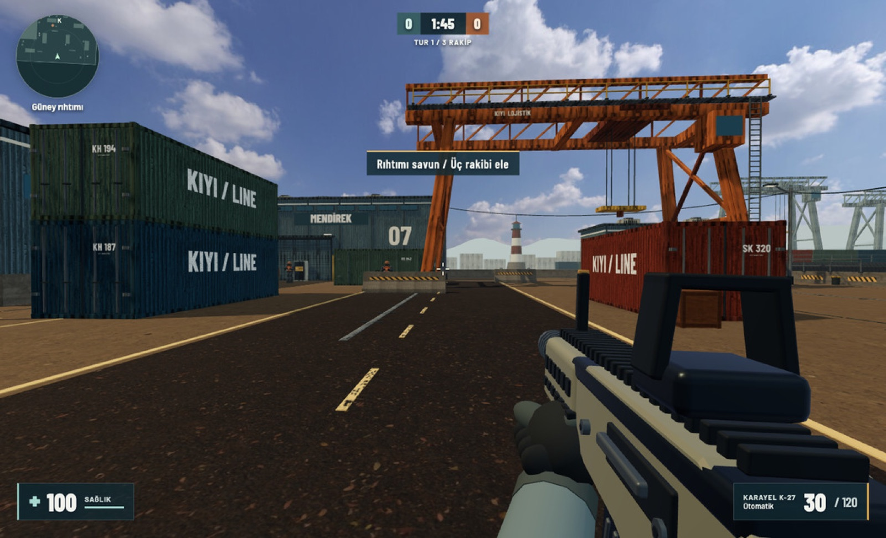

# Yayın 01 · Tek HTML FPS (CS:GO tarzı)

| | |
|---|---|
| Model | GPT-6.2 Astra |
| Efor | Extra High |
| Nasıl başlatıldı | Ana sohbet (GPT-6.2 Astra, Extra High) Taha'nın isteğini kısa bir prompta çevirip ayrı bir Codex sohbeti açtı |
| Başlangıç | 17 Kasım 22:05 (İstanbul saati) |
| Tek prompt mu | Evet, yalnız yayın düzeni için takip mesajları gitti |
| Süre | 19,8 dk (kayıttaki görev süresi) |

## Sonuç

Yayını yavaşlattığı için durduruldu. Durdurulana kadar oyun açılıyordu: Karadeniz'de kurgusal bir yük limanı olan "Mendirek", üç rakibe karşı tur bazlı maç, fotoğraf tabanlı dokular HTML'e gömülü. Model ara mesajında tüfek ve tabancayla ateş, şarjör değiştirme, duraklatma ve oyuna dönmeyi denediğini yazdı. Son oyun testi yarıda kaldı. HTML 4,5 MB olduğu için repoda yok.

Prompt: [prompt.md](prompt.md)
