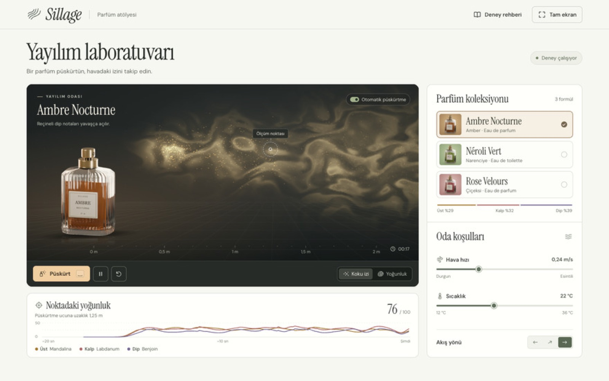

# Yayın 02 · Parfüm yayılım simülasyonu

| | |
|---|---|
| Model | GPT-6.2 Astra |
| Efor | Extra High |
| Nasıl başlatıldı | Ana sohbet (GPT-6.2 Astra, Extra High) Taha'nın isteğini kısa bir prompta çevirip ayrı bir Codex sohbeti açtı |
| Başlangıç | 17 Kasım 22:05 (İstanbul saati) |
| Tek prompt mu | Evet, yalnız yayın düzeni için takip mesajları gitti |
| Süre | 14,5 dk (kayıttaki görev süresi) |

## Sonuç

"Sillage" adlı yayılım laboratuvarı: üç parfüm formülü (üst, kalp, dip nota oranlarıyla), hava hızı, sıcaklık ve akış yönü ayarı, ölçüm noktasında zamanla yoğunluk grafiği. Tek HTML dosyası repoda: [sonuc/sillage.html](sonuc/sillage.html).

Prompt: [prompt.md](prompt.md)
