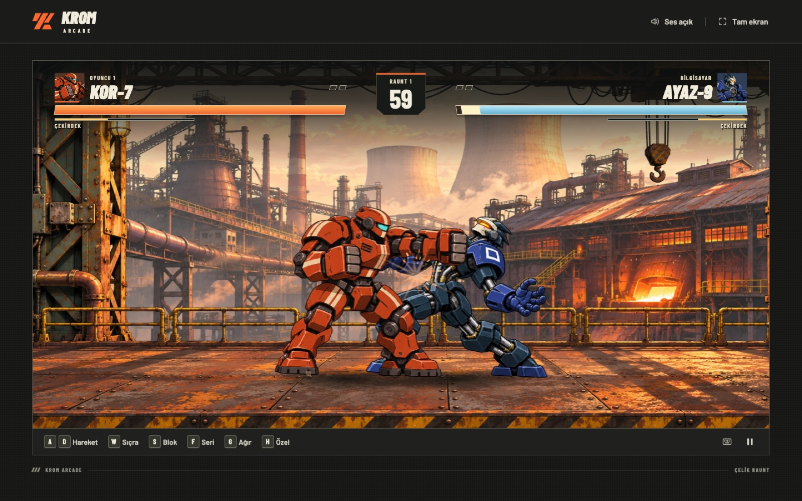

# Yayın 03 · 2D robot savaşı arena oyunu

| | |
|---|---|
| Model | GPT-6.2 Astra |
| Efor | Extra High |
| Nasıl başlatıldı | Ana sohbet (GPT-6.2 Astra, Extra High) Taha'nın isteğini kısa bir prompta çevirip ayrı bir Codex sohbeti açtı |
| Başlangıç | 17 Kasım 22:07 (İstanbul saati) |
| Tek prompt mu | Evet, yalnız yayın düzeni için takip mesajları gitti |
| Süre | 15,0 dk (kayıttaki görev süresi) |

## Sonuç

"Çelik Raunt": dökümhane arenasında bilgisayara karşı ya da aynı klavyede iki kişi; iki raunt alan kazanır. Seri ve ağır yumruk, blok, çekirdek dolunca özel vuruş. Model, headless Chromium'da standart seviyede bir maçı 2-0 bitirdiğini; rövanş, tam ekran, duraklatma ve iki oyunculu modu denediğini yazdı. HTML 2,9 MB olduğu için repoda yok.

Prompt: [prompt.md](prompt.md)
