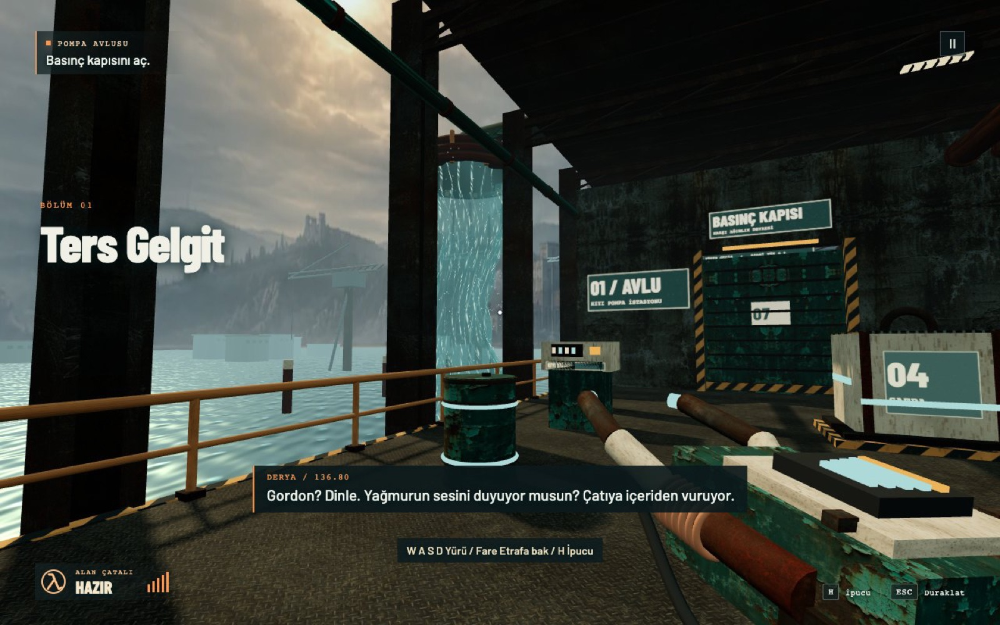

# Yayın 04 · Half-Life 3 fan bölümü (prompt modelden)

| | |
|---|---|
| Model | GPT-6.2 Astra |
| Efor | Extra High |
| Nasıl başlatıldı | Ana sohbet (GPT-6.2 Astra, Extra High) Taha'nın isteğini kısa bir prompta çevirip ayrı bir Codex sohbeti açtı |
| Başlangıç | 17 Kasım 22:07 (İstanbul saati) |
| Tek prompt mu | Evet, yalnız yayın düzeni için takip mesajları gitti |
| Süre | 16,8 dk (kayıttaki görev süresi) |

## Sonuç

"Ters Gelgit": Karadeniz kıyısında bir pompa istasyonu; elindeki "alan çatalı" tuzla kaplı cisimlerin düşüş yönünü tersine çeviriyor. Türkçe telsiz sesleri ve altyazılar tek dosyada. Model bölümü baştan finale oynayarak doğruladığını yazdı. HTML 3,1 MB olduğu için repoda yok.

Prompt: [prompt.md](prompt.md)
