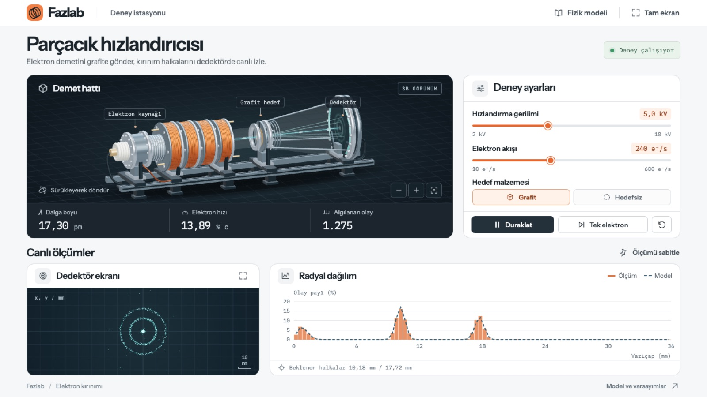

# Yayın 05 · Kuantum düzeyinde parçacık hızlandırıcısı

| | |
|---|---|
| Model | GPT-6.2 Astra |
| Efor | Extra High |
| Nasıl başlatıldı | Ana sohbet (GPT-6.2 Astra, Extra High) Taha'nın isteğini kısa bir prompta çevirip ayrı bir Codex sohbeti açtı |
| Başlangıç | 17 Kasım 22:07 (İstanbul saati) |
| Tek prompt mu | Evet, yalnız yayın düzeni için takip mesajları gitti |
| Süre | 13,5 dk (kayıttaki görev süresi) |

## Sonuç

"Fazlab": elektron demeti grafit hedefe gönderiliyor, dedektörde kırınım halkaları canlı birikiyor. Hızlandırma gerilimi, elektron akışı ve hedef ayarlanabiliyor; ölçülen radyal dağılım modelle üst üste çiziliyor. Tek HTML repoda: [sonuc/fazlab.html](sonuc/fazlab.html).

Prompt: [prompt.md](prompt.md)
