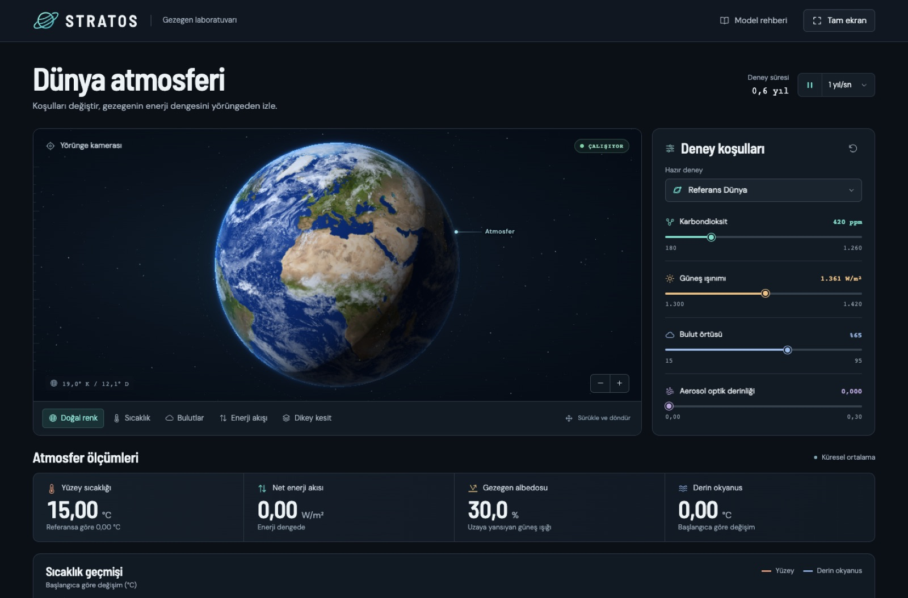

# Yayın 06 · Dünya atmosferi simülasyonu

| | |
|---|---|
| Model | GPT-6.2 Astra |
| Efor | Extra High |
| Nasıl başlatıldı | Ana sohbet (GPT-6.2 Astra, Extra High) Taha'nın isteğini kısa bir prompta çevirip ayrı bir Codex sohbeti açtı |
| Başlangıç | 17 Kasım 22:09 (İstanbul saati) |
| Tek prompt mu | Evet, yalnız yayın düzeni için takip mesajları gitti |
| Süre | 12,8 dk (kayıttaki görev süresi) |

## Sonuç

"Stratos": karbondioksit, Güneş ışınımı, bulut örtüsü ve volkanik aerosol ayarı; 24 enlem kuşağında iklim tepkisi, sanal sonda 80 km'ye kadar. Modelin test notu: "İki kat karbondioksit" deneyinde enerji dengesi +3,71 W/m² değişti, ilk 10 model yılında yüzey 1,82 °C, derin okyanus 0,08 °C ısındı. Bulut hareketi temsili. HTML 2,5 MB olduğu için repoda yok.

Prompt: [prompt.md](prompt.md)
