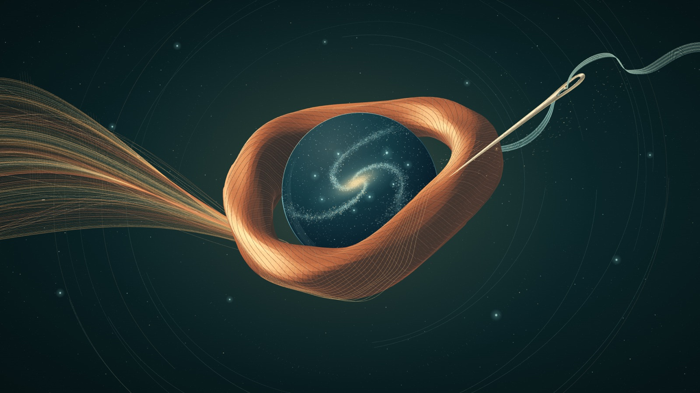

# Yayın 07 · Evrenin dışındaki simülasyon katmanı (SVG)

| | |
|---|---|
| Model | GPT-6.2 Astra |
| Efor | Extra High |
| Nasıl başlatıldı | Ana sohbet (GPT-6.2 Astra, Extra High) Taha'nın isteğini kısa bir prompta çevirip ayrı bir Codex sohbeti açtı |
| Başlangıç | 17 Kasım 22:17 (İstanbul saati) |
| Tek prompt mu | Evet, yalnız yayın düzeni için takip mesajları gitti |
| Süre | 5,7 dk (kayıttaki görev süresi) |

## Sonuç

"Gece Dokuması": evrenin dışında zamanın dokunduğu bir tezgah; bizim gökyüzümüz tek bir ilmeğin içinde, bir iğne sonraki evrenin ipliğini çekiyor (modelin açıklaması). SVG 2,9 MB olduğu için repoda yalnız önizleme var.

Prompt: [prompt.md](prompt.md)
