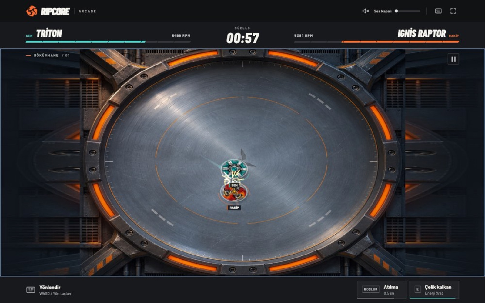

# Yayın 08 · Beyblade tarzı topaç arenası

| | |
|---|---|
| Model | GPT-6.2 Astra |
| Efor | Extra High |
| Nasıl başlatıldı | Ana sohbet (GPT-6.2 Astra, Extra High) Taha'nın isteğini kısa bir prompta çevirip ayrı bir Codex sohbeti açtı |
| Başlangıç | 17 Kasım 22:39 (İstanbul saati) |
| Tek prompt mu | Evet, yalnız yayın düzeni için takip mesajları gitti |
| Süre | 14,4 dk (kayıttaki görev süresi) |

## Sonuç

"Ripcore": üç topaçtan biri seçiliyor, WASD ile maç boyunca yönlendirme, Boşluk ile atılma, enerji dolunca E ile özel güç. Sessiz açılıyor, ses seviyesi ve M ile sessize alma var. Model üç topaçla da maç oynattığını yazdı. Oyun birden çok dosya ve üretilmiş görsellerden oluştuğu için repoda yalnız görüntü var.

Prompt: [prompt.md](prompt.md)
