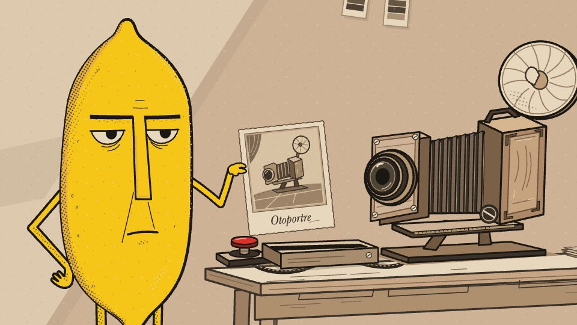

# Yayın 09 · Limon animasyonu, yalnız SVG kodu

| | |
|---|---|
| Model | GPT-6.2 Astra |
| Efor | Extra High |
| Nasıl başlatıldı | Ana sohbet (GPT-6.2 Astra, Extra High) Taha'nın isteğini kısa bir prompta çevirip ayrı bir Codex sohbeti açtı |
| Başlangıç | 17 Kasım 22:41 (İstanbul saati) |
| Tek prompt mu | Evet, yalnız yayın düzeni için takip mesajları gitti |
| Süre | 12,4 dk (kayıttaki görev süresi) |

## Sonuç

"Otoportre": Limon deklanşöre basıyor, körüklü makine kendi portresini basıyor, Limon baskıyı kaldırıp tek kaşını kaldırıyor. Bütün çizim ve hareket elle yazılmış SVG ve SMIL. Model, headless Chrome'da animasyonun otomatik başladığını ve tam 30. saniyede son karede kaldığını doğruladığını yazdı. SVG repoda: [sonuc/limon.svg](sonuc/limon.svg) (tarayıcıda açınca oynar).

İki Limon sürümünün karşılaştırması: [testler/03-limon-karsilastirmasi](../../testler/03-limon-karsilastirmasi/).

Prompt: [prompt.md](prompt.md)
