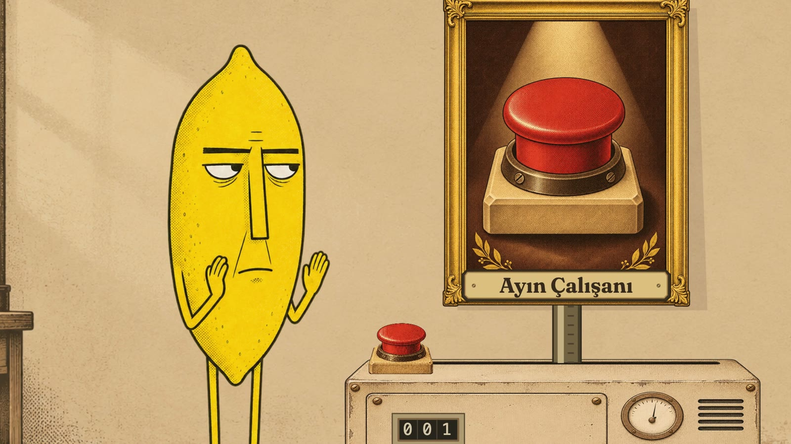
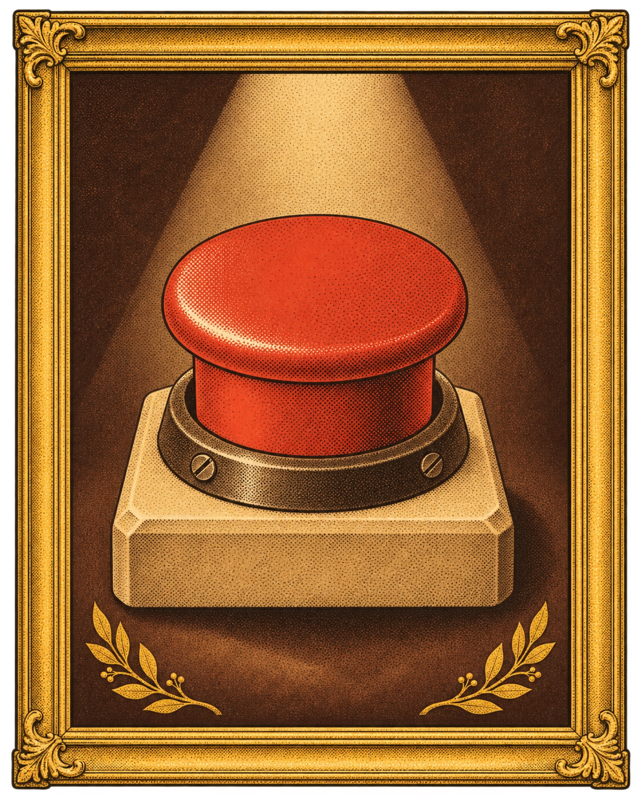

# Yayın 10 · Limon animasyonu, görsel üretimle

| | |
|---|---|
| Model | GPT-6.2 Astra |
| Efor | Extra High |
| Nasıl başlatıldı | Ana sohbet (GPT-6.2 Astra, Extra High) Taha'nın isteğini kısa bir prompta çevirip ayrı bir Codex sohbeti açtı |
| Başlangıç | 17 Kasım 22:41 (İstanbul saati) |
| Tek prompt mu | Evet, yalnız yayın düzeni için takip mesajları gitti |
| Süre | 15,8 dk (kayıttaki görev süresi) |

## Sonuç

"Ayın Çalışanı": yerleşik ImageGen ile onaylı Limon referans verilerek 6 görsel üretildi, Canvas üzerinde zaman koduyla canlandırıldı. Film tam 30 sn, 1920×1080, sessiz; model MP4'ün 900 kare içerdiğini doğruladığını yazdı. Görseller ve film boyut yüzünden repoda yok, bir kare ve bir üretilmiş görsel var.

İki Limon sürümünün karşılaştırması: [testler/03-limon-karsilastirmasi](../../testler/03-limon-karsilastirmasi/).

Prompt: [prompt.md](prompt.md)
