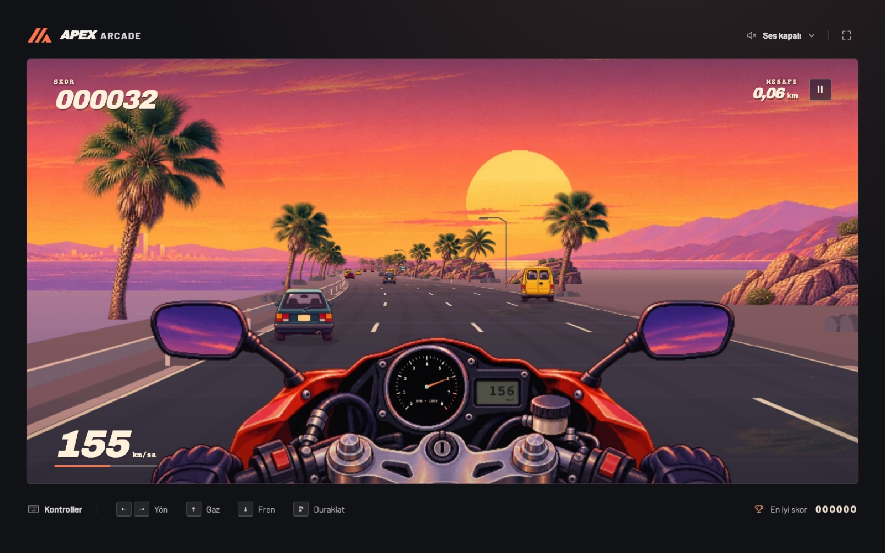

# Yayın 11 · Traffic Rider tarzı motosiklet oyunu

| | |
|---|---|
| Model | GPT-6.2 Astra |
| Efor | Extra High |
| Nasıl başlatıldı | Ana sohbet (GPT-6.2 Astra, Extra High) Taha'nın isteğini kısa bir prompta çevirip ayrı bir Codex sohbeti açtı |
| Başlangıç | 17 Kasım 22:54 (İstanbul saati) |
| Tek prompt mu | Evet, yalnız yayın düzeni için takip mesajları gitti |
| Süre | 32,0 dk (kayıttaki görev süresi) |

## Sonuç

"Sunset Shift": sahil yolunda birinci şahıs sürüş; Enter başlat, ok tuşları gaz, fren ve yön. Sessiz başlıyor, sağ üstte ses ayarı var. Modelin uzun sürüş testi: beş dakikalık simülasyonda 17,39 km ve 445 sollama, hata kaydı yok. Bu oturumun kaydında hız katmanı `ultrafast` görünüyor (diğer Astra testlerinde `priority`, yani Fast). Tek HTML repoda: [sonuc/sunset-shift.html](sonuc/sunset-shift.html).

Prompt: [prompt.md](prompt.md)
